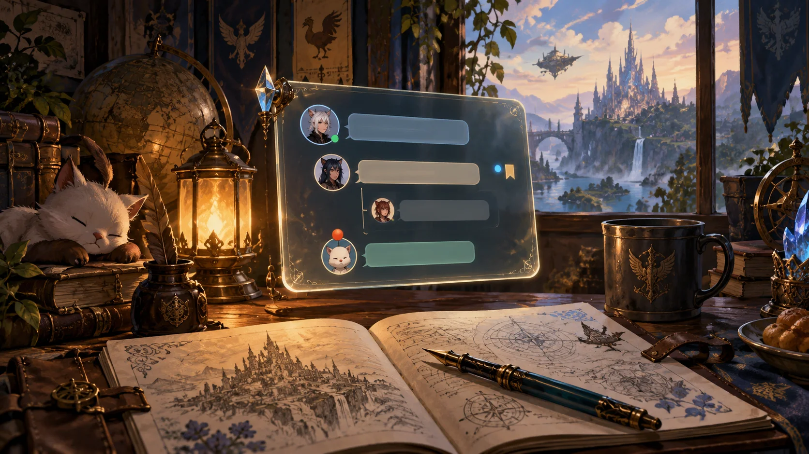
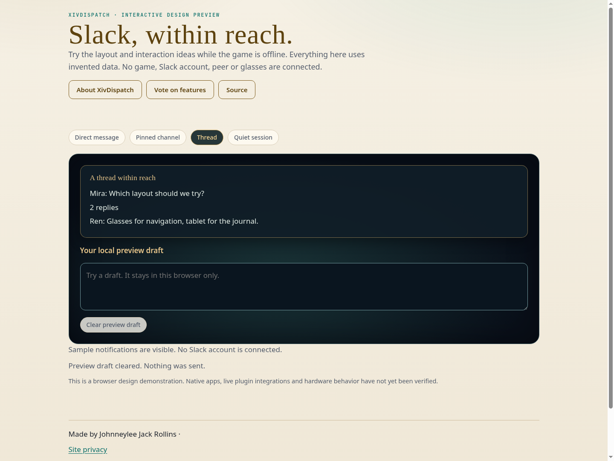

# XivDispatch

Slack, within reach.

A practical Slack companion project for FFXIV: DMs, mentions, threads and persistent drafts, with quiet play sessions and optional Prism panels.



**Status: interactive design preview.** The source builds a browser preview with invented data. There is no installable Dalamud release, live game integration, or verified hardware support yet. The illustration is AI-generated concept artwork, not a screenshot or hardware photograph.

[Project site](https://spacegho.st/mods/ffxiv/xivdispatch/) · [Try the preview](https://spacegho.st/mods/ffxiv/xivdispatch/preview/) · [Vote on features](https://spacegho.st/mods/ffxiv/xivdispatch/vote/) · [Roadmap](ROADMAP.md) · [Architecture](docs/architecture.md)

## Build and run the preview

Node 22 or later is required. Authored browser code and build tooling are native Imba, precompiled to committed JavaScript. Third-party compiler dependencies remain unchanged.

```sh
npm ci --ignore-scripts
npm run build
npm run check
python3 -m http.server 8080 --directory preview
```

Open `http://localhost:8080`. The preview connects to no game, Slack account, network peer or glasses. It uses no credentials. Draft/profile exports describe preview state only.

## Browser preview capture



Captured in Chromium. This is a design demonstration, not a live game or account connection.

## Planned experience

- **The conversations you actually need.** The first dedicated interface is planned around DMs, mentions and pinned channels. Read a thread, keep a draft, react or open the original message. The interactive preview uses a fictional workspace and never connects to Slack.
- **A useful path before a complete custom client.** First evaluate hosting the official Slack app window through Desktop and Ghostty in the Wine/Linux setup. A dedicated compact interface then uses supported Slack APIs and workspace-authorized access. Official app hosting is planned, not verified.
- **Your identity, your deliberate send.** A real client needs authorized user access, rather than silently substituting a bot identity. Credentials stay in the connector on a trusted device. Sending and reactions are explicit actions; an assistant never sends merely because a message appeared.
- **Quiet while you play.** Choose when a conversation deserves attention. Compact notifications, a quiet session and drafts that survive closing the panel make a more useful first release than an attempt to reproduce every Slack feature.
- **A conversation panel for Prism and Camp.** Dispatch will offer a compact panel for glasses or another display and a larger window in a Camp arrangement. Viewers receive only the conversations you choose. A controller should open or dismiss a panel without stealing ordinary game input.
- **What still needs proving.** OAuth, workspace installation policy, event delivery, history limits, message identity and permission revocation need integration checks. There is no Slack connection, live account access or installable Dalamud plugin in this publication.

## Publication and validation

The canonical website registry and ballots are maintained in [ghostty-vote](https://github.com/Spaceghost/ghostty-vote). `metadata/project.json` records this project's identity and honest publication state. `metadata/feature-catalogue.json` mirrors the initial public ballot. No release archives or plugin installer entries are published for this preview.

The CI verifies precompiled output and builds the browser preview. Real game, account, display, hotplug and input checks remain acceptance work, tracked in the roadmap.

Made by Johnneylee Jack Rollins. An independent fan project, not affiliated with Square Enix or hardware/service vendors. Source is MIT licensed; generated artwork attribution is in `docs/art/provenance.json`.
